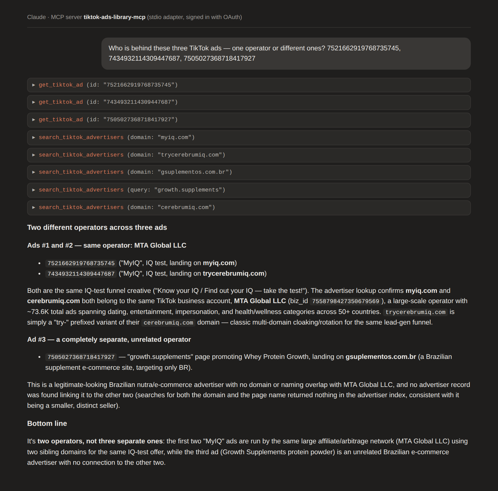

# TikTok Ads Library MCP Server

[](LICENSE)

Research TikTok ads from your AI assistant: search the ads running in a country or a category,
open any of them, and find the advertiser operations behind them — from one conversation.

This is a scenario adapter for the hosted [Spytrend MCP server](https://spytrend.com/mcp/?utm_source=github-tiktok-ads-library-mcp&utm_medium=repo&utm_campaign=mcp-launch).
Spytrend keeps a separate TikTok corpus next to its Meta corpus; this adapter pins every call to
TikTok, so the assistant cannot silently fall back to Meta results. TikTok coverage is part of
the Pro plan and above.

## Example prompts

> What TikTok ads are running for skincare in the United States right now?

> Show me TikTok ads that lead to **example-store.com**. When did the first one start?

> Open this TikTok ad id and tell me the hook, the offer and the destination.

> Who is behind these three TikTok ads — one operator or different ones?

> How many TikTok rows can I still pull on my plan?



## Connect

### Option A — hosted server, nothing to install (recommended)

**Endpoint**

```text
https://mcp.spytrend.com/mcp
```

**Sign-in:** your Spytrend account, in the browser. No API key, no token to paste. The hosted
server serves Meta and TikTok through the same tools and picks the source per call; ask your
assistant for TikTok explicitly. This adapter fixes the source to TikTok for you.

1. Open your client's connector settings.
2. Add a remote MCP server and give it the URL above.
3. Sign in when the browser window opens, and start asking.

Per-client walkthroughs (Claude, ChatGPT, Cursor, Codex, VS Code):
[Spytrend/spytrend-mcp → docs/quickstart.md](https://github.com/Spytrend/spytrend-mcp/blob/main/docs/quickstart.md).

### Option B — this adapter (TikTok-only, source pinned)

Requires Node 20+ (20.18.1 or newer). The adapter runs locally over stdio and forwards its tool calls to the hosted
server above; the first call opens the same Spytrend sign-in in your browser. The sign-in token is kept on your
machine by [mcp-remote](https://github.com/geelen/mcp-remote) in `~/.mcp-auth` (set
`MCP_REMOTE_CONFIG_DIR` to move it); delete that folder to sign out. Nothing goes into this
repository or your client config.

Claude Desktop, Cursor, or any stdio client:

```json
{
  "mcpServers": {
    "tiktok-ads-library": {
      "command": "npx",
      "args": ["-y", "github:Spytrend/tiktok-ads-library-mcp"]
    }
  }
}
```

Claude Code:

```bash
claude mcp add tiktok-ads-library -- npx -y github:Spytrend/tiktok-ads-library-mcp
```

## Tools (5)

| Tool | What it does |
|---|---|
| `search_tiktok_ads` | Search TikTok ads by text, country, category or landing domain |
| `get_tiktok_ad` | Open one TikTok ad: copy, destination, run dates |
| `search_tiktok_advertisers` | Find the advertiser operations behind TikTok ads |
| `get_tiktok_advertiser` | One operation: domains, pages, countries, volume |
| `get_usage` | Your plan and remaining quota (free) |

Pricing is the server's. TikTok rows are premium: 100 Spytrend tokens per delivered row, Pro
plan or higher. The default page size is 10 rows; ask for fewer if you are sampling. Media
download is not available for TikTok ids. Details:
[spytrend.com/mcp](https://spytrend.com/mcp/?utm_source=github-tiktok-ads-library-mcp&utm_medium=repo&utm_campaign=mcp-launch).

## What this is and is not

- It queries Spytrend's own database. It does not scrape TikTok, does not ship TikTok code and
  does not bypass any platform access control.
- TikTok is a trademark of TikTok Ltd. This project is not affiliated with, endorsed by or
  sponsored by TikTok or ByteDance.
- For the full server with Meta coverage, all 22 tools and six ready-made research workflows,
  see the canonical repository: [Spytrend/spytrend-mcp](https://github.com/Spytrend/spytrend-mcp).

## Support

Questions about connecting, access or your account: [spytrend.com/contact](https://spytrend.com/contact/?utm_source=github-tiktok-ads-library-mcp&utm_medium=repo&utm_campaign=mcp-launch).
Something wrong in this repository: open an issue. Security reports go through the route
described in the canonical repository's [SECURITY.md](https://github.com/Spytrend/spytrend-mcp/blob/main/SECURITY.md),
never through issues.

## License

MIT — see [LICENSE](LICENSE). The licence covers this adapter and its documentation. The
server itself is part of the Spytrend platform.
